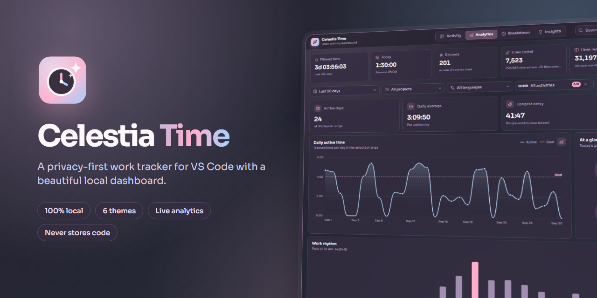
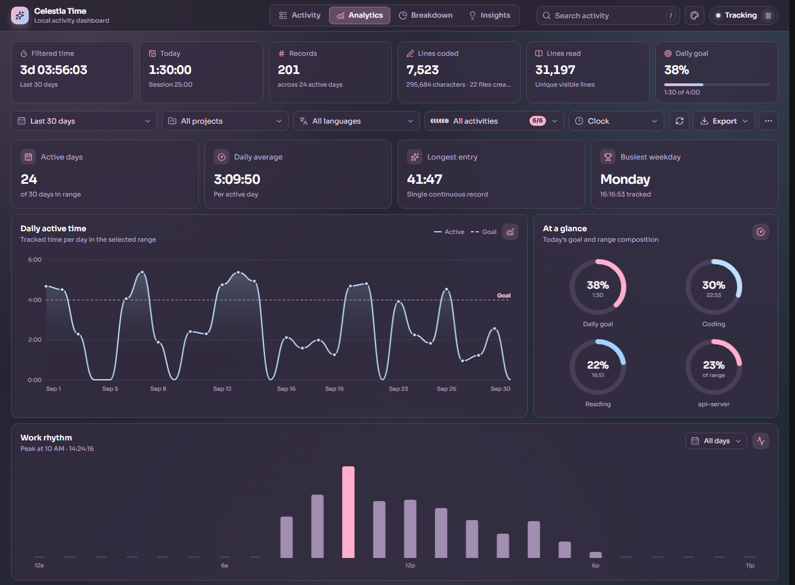
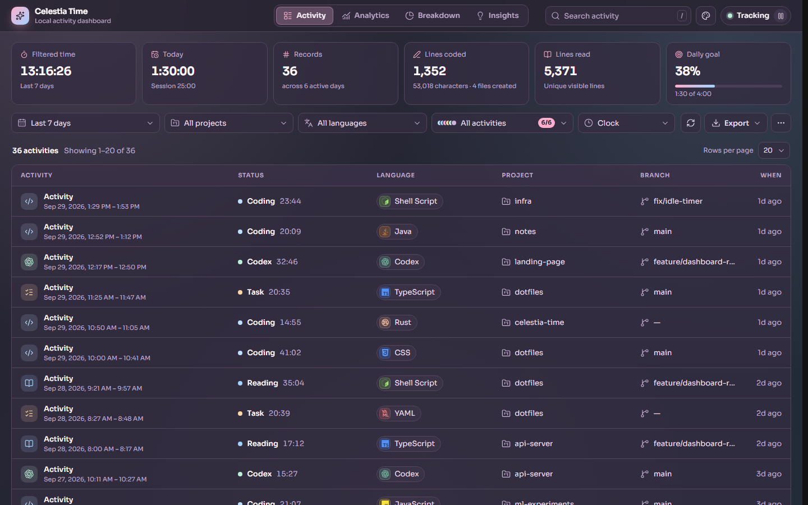
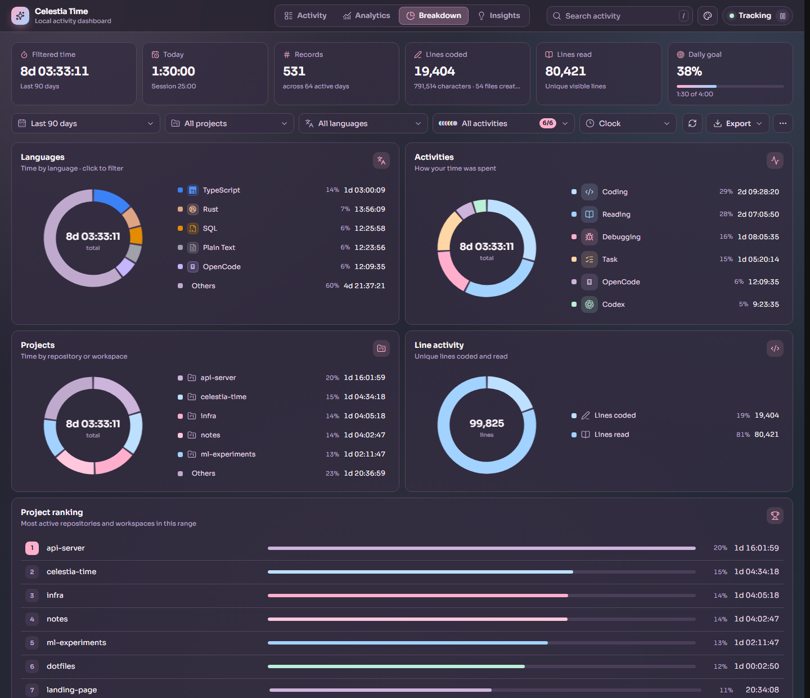
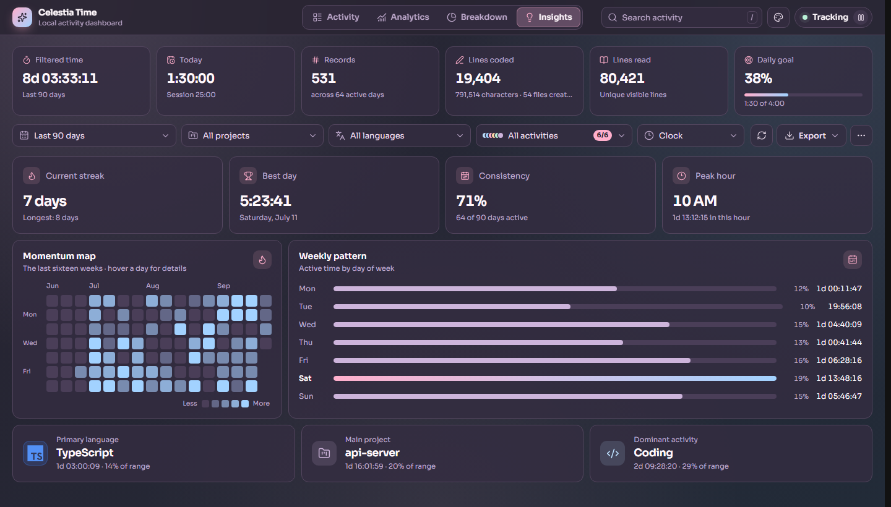
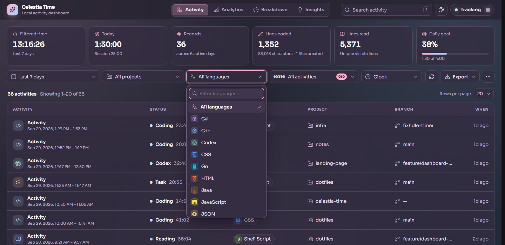
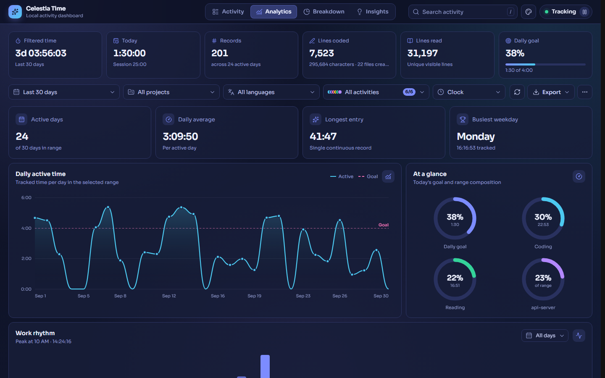
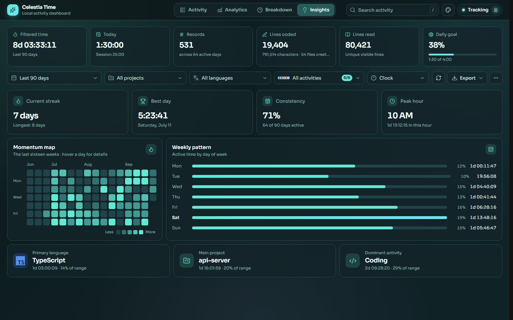
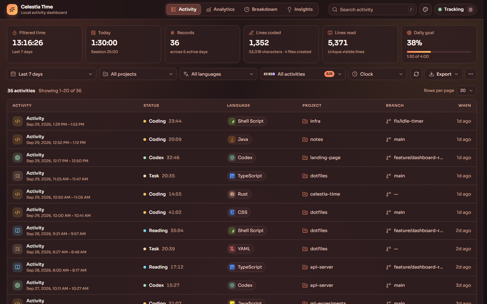
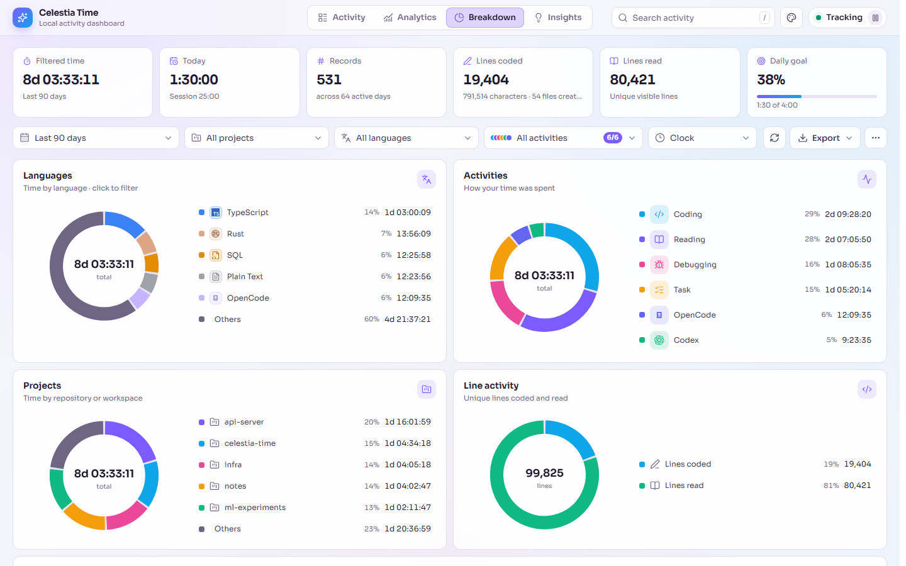

<p align="center">
  
</p>

<p align="center">
  <a href="https://github.com/x-mori/celestia-time/releases/latest"></a>
  
  
  
</p>

<p align="center">
  <b>Track your focus, not your code.</b><br>
  Celestia Time (feat. Celestiarinabelle) records how you spend time in VS Code, stops the clock when you go idle,<br>
  and turns it into a live dashboard. Everything stays on your machine.
</p>

<p align="center">
  <a href="#-installation">Installation</a> ·
  <a href="#-features">Features</a> ·
  <a href="#-themes">Themes</a> ·
  <a href="#-privacy">Privacy</a> ·
  <a href="#%EF%B8%8F-settings">Settings</a> ·
  <a href="CHANGELOG.md">Changelog</a>
</p>

---

## 📦 Installation

1. Download **`celestia-time-1.0.0.vsix`** from the [latest release](https://github.com/x-mori/celestia-time/releases/latest).
2. Install it using either method:

   **From VS Code:** open the Extensions view (`Ctrl+Shift+X`), click the **`···`** menu, then **Install from VSIX…** and pick the file.

   **From a terminal:**

   ```powershell
   code --install-extension celestia-time-1.0.0.vsix
   ```

3. Run **Developer: Reload Window**. A timer appears in the status bar; click it to open the dashboard.

> [!TIP]
> Updating from an earlier version? Install the new `.vsix` over the old one. Your tracked history is kept in VS Code's storage, not in the extension, so nothing is lost.

## ✨ Features

<table>
  <tr>
    <td width="50%" valign="top">
      <h3>⏱️ Automatic tracking</h3>
      Coding, reading, debugging, tasks, and Codex and OpenCode sessions are detected automatically. The timer stops after a configurable idle timeout and pauses as soon as VS Code loses focus.
    </td>
    <td width="50%" valign="top">
      <h3>📊 Live dashboard</h3>
      Four pages (Activity, Analytics, Breakdown, and Insights) with daily trends, a goal line, an hourly rhythm, streaks, a momentum heatmap, and a weekly pattern.
    </td>
  </tr>
  <tr>
    <td valign="top">
      <h3>🎨 Six themes</h3>
      Pastel Dreamland, Midnight Nebula, Aurora Mint, Ember Sunset, Daylight, or <i>Match VS Code</i>. Charts and brand-tinted language icons change with the theme.
    </td>
    <td valign="top">
      <h3>🔎 Fast filtering</h3>
      Search with <kbd>/</kbd>, filter by project, language, activity, and date range, or click any chip, legend row, or ranking to drill in. Your view is remembered.
    </td>
  </tr>
  <tr>
    <td valign="top">
      <h3>📝 Line metrics</h3>
      Unique lines coded and read per day, characters written, and files created. Only counts are stored, never text.
    </td>
    <td valign="top">
      <h3>🔒 Local and private</h3>
      No network requests. Daily JSONL files you can inspect, export to JSON or CSV, or delete at any time.
    </td>
  </tr>
</table>

### Dashboard tour

<p align="center">
  
</p>

<details open>
<summary><b>Activity</b>: every tracked session with language, project, and branch</summary>
<br>

</details>

<details>
<summary><b>Breakdown</b>: time by language, activity, and project, with a project ranking</summary>
<br>

</details>

<details>
<summary><b>Insights</b>: streaks, best day, consistency, peak hour, momentum map, and weekly pattern</summary>
<br>

</details>

<details>
<summary><b>Filters and menus</b>: searchable, keyboard-friendly dropdowns</summary>
<br>

</details>

## 🎨 Themes

Pick a theme from the **palette** button in the dashboard header, or set `celestiaTime.dashboard.theme`.

<table>
  <tr>
    <td align="center"><br><b>Midnight Nebula</b></td>
    <td align="center"><br><b>Aurora Mint</b></td>
  </tr>
  <tr>
    <td align="center"><br><b>Ember Sunset</b></td>
    <td align="center"><br><b>Daylight</b></td>
  </tr>
</table>

The default is **Pastel Dreamland** (shown above). **Match VS Code** uses your editor's colors, including light and high-contrast themes.

## 🧭 Commands

| Command | What it does |
| --- | --- |
| `Celestia Time: Open Dashboard` | Opens the dashboard. Clicking the status-bar timer does the same. |
| `Celestia Time: Toggle Tracking` | Pauses or resumes tracking. Also available from the dashboard's status chip. |
| `Celestia Time: Export Tracking Data` | Saves all records as JSON or CSV. |
| `Celestia Time: Open Local Data Folder` | Opens the folder containing the daily activity files. |
| `Celestia Time: Delete All Tracking Data` | Permanently deletes all local records, after confirmation. |

**Dashboard shortcuts:** <kbd>/</kbd> focuses search · <kbd>←</kbd> <kbd>→</kbd> switch pages when a tab is focused · <kbd>↑</kbd> <kbd>↓</kbd> <kbd>Enter</kbd> <kbd>Esc</kbd> navigate menus.

## 🔒 Privacy

Celestia Time is **local-only** and makes **no network requests**.

- 🚫 File contents are never stored. Line metrics are counts only.
- 🙈 File names are **off** by default and can be hashed, reduced to base names, or stored as relative paths.
- 🏷️ Repository and workspace names stay on your machine and can be hashed or disabled.
- 🌿 Git branch names come from VS Code's built-in Git extension and can be turned off.
- 🤖 For AI tools, only the tool name and timing are recorded. Prompts, responses, and terminal output are never stored.
- 🧹 Excluded paths (for example `.env`, `node_modules`, and build output) are rejected before any record is created.

Activity is written as one JSONL file per day in VS Code's extension storage. Run **Celestia Time: Open Local Data Folder** to see exactly what is stored.

## ⚙️ Settings

Search for **Celestia Time** in VS Code Settings.

| Setting | Default | Description |
| --- | --- | --- |
| `celestiaTime.enabled` | `true` | Turns automatic tracking on or off. |
| `celestiaTime.idleTimeoutSeconds` | `120` | Seconds without activity before the timer stops. |
| `celestiaTime.flushIntervalSeconds` | `30` | How often active time is written to disk. |
| `celestiaTime.dailyGoalMinutes` | `240` | Daily goal. `0` turns goal tracking off. |
| `celestiaTime.timeFormat` | `clock` | `clock` (`1:02:03`), `units` (`1h 2m 3s`), or `decimal` (`1.03 hrs`). |
| `celestiaTime.dashboard.theme` | `dreamland` | `dreamland`, `midnight`, `aurora`, `sunset`, `daylight`, or `vscode`. |
| `celestiaTime.dashboard.historyDays` | `90` | Days of history the dashboard loads. |
| `celestiaTime.statusBar.format` | `$(pulse) {today}` | Status-bar template. Placeholders: `{today}`, `{session}`, `{state}`, `{language}`. |
| `celestiaTime.statusBar.alignment` | `right` | Status-bar side. |
| `celestiaTime.statusBar.priority` | `100` | Status-bar position priority. |
| `celestiaTime.track.languages` | `true` | Record language IDs. |
| `celestiaTime.track.projects` | `true` | Record repository or workspace names. |
| `celestiaTime.track.gitBranches` | `true` | Record Git branch names. |
| `celestiaTime.track.aiTools` | `true` | Detect Codex and OpenCode sessions. |
| `celestiaTime.privacy.workspaceNames` | `full` | `full`, `hashed`, or `disabled`. |
| `celestiaTime.privacy.fileNames` | `disabled` | `disabled`, `hashed`, `basename`, or `relative`. |
| `celestiaTime.exclude` | *see settings* | Glob patterns excluded from tracking. |
| `celestiaTime.retentionDays` | `365` | Records older than this are deleted automatically. |

## 📄 License

[MIT](LICENSE) © Fujimori. Language icons come from [Devicon](https://devicon.dev), interface icons from [Lucide](https://lucide.dev), and the typeface is [Sora](https://github.com/sora-xor/sora-font). See [THIRD_PARTY_NOTICES.md](THIRD_PARTY_NOTICES.md).

<p align="center"><sub>Made with 💜 for focused, private work.</sub></p>
